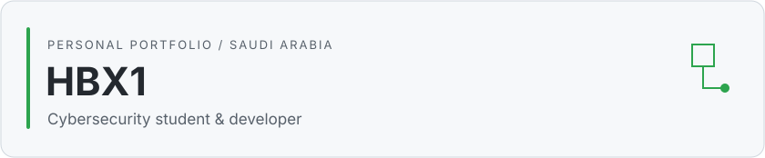
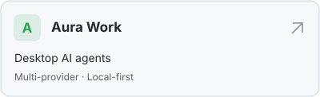
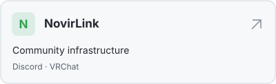
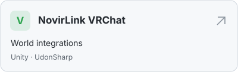
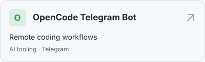

I build AI developer tools, desktop applications and integrations between Discord and VRChat, with an interest in application security and local-first software.

[Repositories](https://github.com/hbx12?tab=repositories) · [Aura Work](https://aura-work.shop) · [NovirLink](https://novirlink.shop)

## Selected projects

Also building [NovirLink Mini](https://novirlink-mini.shop) and exploring open-source development with [OpenCode](https://github.com/hbx12/opencode) and [OpenWork](https://github.com/hbx12/openwork).

## Areas of interest

| Area | Focus |
| :--- | :--- |
| Security | Application security, access control, approval workflows |
| AI systems | Local models, agent tooling, provider integrations |
| Engineering | Desktop and web applications, APIs, databases |
| Connected environments | Discord, Unity, VRChat |

## Toolchain

TypeScript · Python · Rust · C# · React · Next.js · Node.js · Tauri · PostgreSQL · SQLite · Unity · Linux

## Contributions

<picture>
  <source media="(prefers-color-scheme: dark)" srcset="https://raw.githubusercontent.com/hbx12/hbx12/output/github-snake-dark.svg" />
  <source media="(prefers-color-scheme: light)" srcset="https://raw.githubusercontent.com/hbx12/hbx12/output/github-snake.svg" />
  
</picture>
